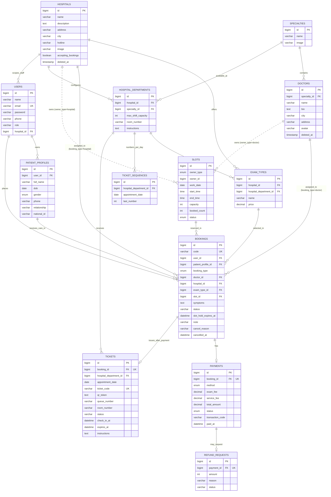

# Database Schema — MedSi

Tài liệu này là nguồn tham chiếu cho mô hình dữ liệu của MedSi. Các
migration và API phải dùng đúng tên bảng, tên cột và quan hệ dưới đây.

## ERD

## Bảng và quy tắc

| Bảng | Vai trò và ràng buộc chính |
|---|---|
| `users` | Tài khoản đăng nhập; `email` duy nhất; `role` gồm `patient`, `admin`, `hospital_admin`, `staff`, `kiosk`. Các role viện cần `hospital_id`. Bác sĩ chưa có role tài khoản riêng. |
| `patient_profiles` | Người được chăm sóc thuộc một tài khoản qua `user_id`; lưu thông tin người bệnh và quan hệ với chủ tài khoản. |
| `specialties` | Danh mục chuyên khoa, gồm tên và ảnh. |
| `doctors` | Hồ sơ bác sĩ thuộc một `specialty_id`; có `address`, index theo `specialty_id` và `city`, dùng soft delete. Không gắn trực tiếp với tài khoản `users`. |
| `hospitals` | Cơ sở khám; `accepting_bookings` chặn đặt/thanh toán mới khi đóng nhận khám; dùng soft delete và index theo `city`. |
| `hospital_departments` | Unique `(hospital_id, specialty_id)`; cấu hình sức chứa mỗi ca, phòng và hướng dẫn. |
| `exam_types` | Dịch vụ thuộc viện và department; dùng soft delete. Giữ `price` để tương thích dữ liệu cũ; phí BKH được cố định 200.000đ khám + 20.000đ dịch vụ. |
| `slots` | Khung giờ dùng đa hình: `owner_type` là `doctor` hoặc `hospital`, `owner_id` trỏ tới thực thể tương ứng. `booked_count` không vượt quá `capacity`. |
| `bookings` | Lượt đặt lịch; `code` duy nhất. `booking_type` quyết định dùng `doctor_id` hay `hospital_id`/`exam_type_id`. Không unique cứng theo hồ sơ/slot để cho đặt lại sau hủy; service kiểm tra trùng lịch active trong transaction. |
| `payments` | Tối đa một thanh toán cho mỗi booking (`booking_id` duy nhất); tổng tiền gồm `exam_fee`, `service_fee` và `total_amount`, có thể ghi `paid_at`. |
| `ticket_sequences` | Unique `(hospital_department_id, appointment_date)`; bộ đếm STT tăng, không giảm/tái sử dụng khi hủy. |
| `tickets` | Một phiếu/booking; `ticket_code` duy nhất; unique department/ngày/STT. QR là JWT HS256 được kiểm tra cùng trạng thái trong DB. |
| `refund_requests` | Một yêu cầu/payment; `amount` là số nguyên VNĐ. `pending` chờ bộ xử lý PAY, không biểu thị đã hoàn tiền ngân hàng. |

Khi tạo hoặc hủy booking, cập nhật `slots.booked_count` trong cùng transaction.
Luồng hospital khóa theo thứ tự user → hospital → slot → booking → payment;
khóa viện bảo vệ cả sức chứa department/ca khi đặt các slot khác nhau. Booking
đang giữ chỗ có thể dùng `slot_hold_expires_at`; quy trình dọn giữ chỗ phải
giải phóng số lượng đã đặt khi thời hạn hết.

`owner_type` của `slots` chỉ nhận `doctor` hoặc `hospital`; cặp
`owner_type`/`owner_id` được kiểm soát ở tầng Eloquent vì đây là quan hệ đa hình
và không có FK database. Booking loại `doctor` phải có `doctor_id` và để
`hospital_id`/`exam_type_id` null; booking loại `hospital` phải có cả
`hospital_id` và `exam_type_id`, để `doctor_id` null. Các điều kiện này do
Booking Service bảo đảm.

Trạng thái hospital booking: `pending_payment` → `confirmed` → `checked_in` →
`completed`; các nhánh kết thúc gồm `cancelled` và `no_show`. Booking bác sĩ vẫn
có `pending`/`rejected`. Ticket có `issued`, `checked_in`, `completed`, `cancelled`,
`expired`; hết ca + 120 phút mà chưa check-in sẽ chuyển ticket `expired` và booking `no_show`.
